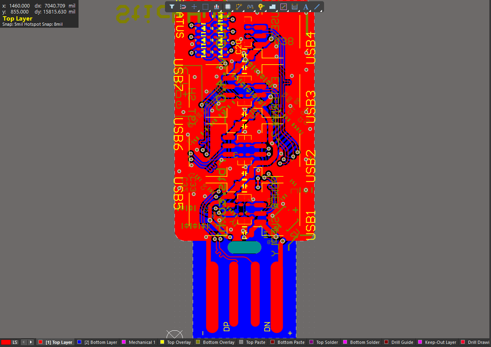

# StickHub in Altium Designer 26.11.1

Converted by kicad2altium from branch `k2a-ad26-open` (KiCad demos at 10.0.7, with their `.kicad_pro`), opened, checked and saved back by script in Altium Designer Professional 26.11.1 on Windows 11.

## 1. Open

No dialog, warning or error.

## 2. Look



## 3. Layer stack

2 copper layers: Top Layer, Bottom Layer.

Physical stack, top to bottom: Top Paste, Top Overlay, Top Solder, Top Layer, Dielectric 1, Bottom Layer, Bottom Solder, Bottom Overlay, Bottom Paste.

Mechanical layers in use: 1 Mechanical 1, 46 F.Fab, 47 B.Fab, 48 F.Courtyard, 49 B.Courtyard, 50 User.Drawings, 51 User.Comments, 52 F.Adhesive, 53 B.Adhesive, 54 User.Eco1, 55 User.Eco2, 56 Margin, 57 Mechanical 57, 58 Mechanical 58.

## 4. Counts

kicad2altium printed: 94 components, 278 pads, 87 vias, 2074 tracks, 526 arcs, 223 texts, 5 polygons, 247 regions, 47 nets, 4 models, 16 componentbodies

| | Altium (all) | not in a component |
|---|---|---|
| components | 94 | 94 |
| nets | 47 | 47 |
| pads | 278 | 0 |
| vias | 87 | 87 |
| tracks | 1263 | 1152 |
| arcs | 193 | 180 |
| texts | 116 | 9 |
| polygons | 5 | 5 |
| regions | 240 | 24 |
| component bodies | 0 | 0 |
| rules | 42 | 42 |
| classes | 17 | 17 |

Inside components (group iterator): pads=278 tracks=918 arcs=346 texts=26 regions=224 fills=0 bodies=16.

Altium's board iterator does not visit every primitive inside components; their tracks, texts and pads are counted by the group iterator above, and the ASCII save below lists every record.

## 5. Polygons

Repour All: before polygons=5 pour primitives=11; after polygons=5 pour primitives=66. No error or dialog.

## 6. DRC

Default options, after the repour. Violations per rule (Altium stops at 500):

```
0  Clearance Constraint (Gap=5.906mil) (All),(All)
     0  Short-Circuit Constraint (Allowed=No) (All),(All)
     0  Un-Routed Net Constraint ( (All) )
     0  Modified Polygon (Allow modified: No), (Allow shelved: No)
     0  Width Constraint (Min=5.906mil) (Max=23.622mil) (Preferred=5.906mil) (All)
     0  Routing Topology Rule(Topology=Shortest) (All)
     0  Power Plane Connect Rule(Relief Connect )(Expansion=20mil) (Conductor Width=10mil) (Air Gap=10mil) (Entries=4) (All)
     0  Minimum Annular Ring (Minimum=3.937mil) (All)
     0  Hole Size Constraint (Min=9.842mil) (Max=157.48mil) (All)
     0  Hole To Hole Clearance (Gap=9.842mil) (All),(All)
     0  Minimum Solder Mask Sliver (Gap=10mil) (All),(All)
   498  Silk To Solder Mask (Clearance=10mil) (IsPad),(All)
     0  Silk to Silk (Clearance=0mil) (All),(All)
     2  Net Antennae (Tolerance=0mil) (All)
     0  Board Clearance Constraint (Gap=0mil) (All)
     0  Height Constraint (Min=0mil) (Max=1000mil) (Prefered=500mil) (All)
   500  TOTAL
```

## 7. Saved back

`StickHub.altium-saved.PcbDoc` (PCB Binary) and `StickHub.altium-ascii.PcbDoc` (PCB ASCII), saved without changes after opening (files over 20 MB gzipped).
