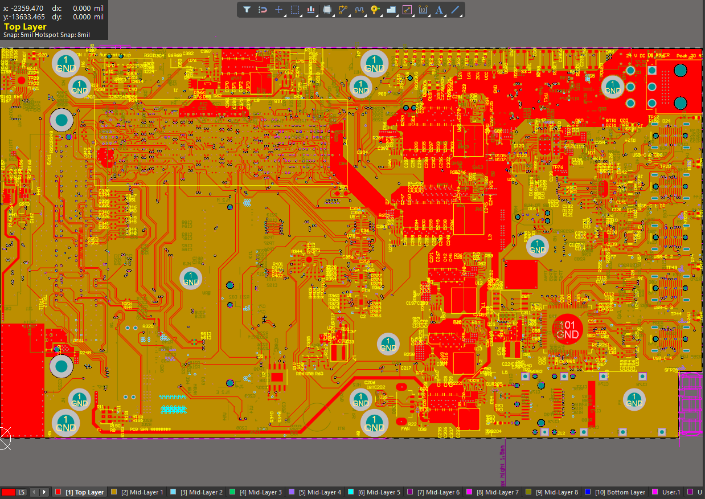

# jetson-agx-thor-baseboard in Altium Designer 26.11.1

Converted by kicad2altium from branch `k2a-ad26-open` (KiCad demos at 10.0.7, with their `.kicad_pro`), opened, checked and saved back by script in Altium Designer Professional 26.11.1 on Windows 11.

## 1. Open

No dialog, warning or error.

## 2. Look



## 3. Layer stack

10 copper layers: Top Layer, Mid-Layer 1, Mid-Layer 2, Mid-Layer 3, Mid-Layer 4, Mid-Layer 5, Mid-Layer 6, Mid-Layer 7, Mid-Layer 8, Bottom Layer.

Physical stack, top to bottom: Top Paste, Top Overlay, Top Solder, Top Layer, Dielectric 1, Mid-Layer 1, Dielectric 2, Mid-Layer 2, Dielectric 3, Mid-Layer 3, Dielectric 4, Mid-Layer 4, Dielectric 5, Mid-Layer 5, Dielectric 6, Mid-Layer 6, Dielectric 7, Mid-Layer 7, Dielectric 8, Mid-Layer 8, Dielectric 9, Bottom Layer, Bottom Solder, Bottom Overlay, Bottom Paste.

Mechanical layers in use: 1 User.1, 2 User.2, 3 User.3, 4 User.4, 5 User.5, 6 User.6, 7 User.7, 8 User.8, 9 overlay, 46 F.Fab, 47 B.Fab, 48 F.Courtyard, 49 B.Courtyard, 50 User.Drawings, 51 User.Comments, 52 F.Adhesive, 53 B.Adhesive, 54 User.Eco1, 55 User.Eco2, 56 Margin.

## 4. Counts

kicad2altium printed: 1125 components, 4862 pads, 3235 vias, 361308 tracks, 3282 arcs, 5776 texts, 100 polygons, 376 regions, 1387 nets, 0 models, 0 componentbodies

| | Altium (all) | not in a component |
|---|---|---|
| components | 1125 | 1125 |
| nets | 1387 | 1387 |
| pads | 4862 | 0 |
| vias | 3235 | 3235 |
| tracks | 234122 | 19874 |
| arcs | 3095 | 2316 |
| texts | 1196 | 43 |
| polygons | 100 | 100 |
| regions | 309 | 173 |
| component bodies | 0 | 0 |
| rules | 186 | 186 |
| classes | 23 | 23 |

Inside components (group iterator): pads=4862 tracks=222900 arcs=966 texts=3411 regions=136 fills=0 bodies=0.

Altium's board iterator does not visit every primitive inside components; their tracks, texts and pads are counted by the group iterator above, and the ASCII save below lists every record.

## 5. Polygons

Repour All: before polygons=100 pour primitives=120; after polygons=100 pour primitives=1090. No error or dialog.

## 6. DRC

Default options, after the repour. Violations per rule (Altium stops at 500):

```
0  Clearance Constraint (Gap=4.921mil) (InNamedPolygon('Polygon 44')),(All)
     0  Clearance Constraint (Gap=4.921mil) (InNamedPolygon('Polygon 43')),(All)
     0  Clearance Constraint (Gap=4.921mil) (InNamedPolygon('Polygon 40')),(All)
     0  Clearance Constraint (Gap=4.921mil) (InNamedPolygon('Polygon 45')),(All)
     0  Clearance Constraint (Gap=4.921mil) (InNamedPolygon('Polygon 48')),(All)
     0  Clearance Constraint (Gap=4.921mil) (InNamedPolygon('Polygon 47')),(All)
     0  Clearance Constraint (Gap=4.921mil) (InNamedPolygon('Polygon 46')),(All)
     0  Clearance Constraint (Gap=4.921mil) (InNamedPolygon('Polygon 33')),(All)
     0  Clearance Constraint (Gap=4.921mil) (InNamedPolygon('Polygon 32')),(All)
     0  Clearance Constraint (Gap=4.921mil) (InNamedPolygon('Polygon 31')),(All)
     0  Clearance Constraint (Gap=4.921mil) (InNamedPolygon('Polygon 34')),(All)
     0  Clearance Constraint (Gap=4.921mil) (InNamedPolygon('Polygon 39')),(All)
     0  Clearance Constraint (Gap=4.921mil) (InNamedPolygon('Polygon 37')),(All)
     0  Clearance Constraint (Gap=4.921mil) (InNamedPolygon('Polygon 35')),(All)
     0  Clearance Constraint (Gap=4.921mil) (InNamedPolygon('Polygon 93')),(All)
     0  Clearance Constraint (Gap=4.921mil) (InNamedPolygon('Polygon 92')),(All)
     0  Clearance Constraint (Gap=4.921mil) (InNamedPolygon('Polygon 91')),(All)
     0  Clearance Constraint (Gap=4.921mil) (InNamedPolygon('Polygon 94')),(All)
     0  Clearance Constraint (Gap=4.921mil) (InNamedPolygon('Polygon 97')),(All)
     0  Clearance Constraint (Gap=4.921mil) (InNamedPolygon('Polygon 96')),(All)
     0  Clearance Constraint (Gap=4.921mil) (InNamedPolygon('Polygon 95')),(All)
     0  Clearance Constraint (Gap=4.921mil) (InNamedPolygon('Polygon 60')),(All)
     0  Clearance Constraint (Gap=4.921mil) (InNamedPolygon('Polygon 57')),(All)
     0  Clearance Constraint (Gap=4.921mil) (InNamedPolygon('Polygon 51')),(All)
     0  Clearance Constraint (Gap=4.921mil) (InNamedPolygon('Polygon 67')),(All)
     0  Clearance Constraint (Gap=4.921mil) (InNamedPolygon('Polygon 90')),(All)
     0  Clearance Constraint (Gap=4.921mil) (InNamedPolygon('Polygon 89')),(All)
     0  Clearance Constraint (Gap=4.921mil) (InNamedPolygon('Polygon 72')),(All)
     0  Clearance Constraint (Gap=4.921mil) (InNamedPolygon('Polygon 30')),(All)
     0  Clearance Constraint (Gap=4.921mil) (InNamedPolygon('Polygon 9')),(All)
     0  Clearance Constraint (Gap=4.921mil) (InNamedPolygon('Polygon 7')),(All)
     0  Clearance Constraint (Gap=4.921mil) (InNamedPolygon('Polygon 10')),(All)
     0  Clearance Constraint (Gap=4.921mil) (InNamedPolygon('Polygon 14')),(All)
     0  Clearance Constraint (Gap=4.921mil) (InNamedPolygon('Polygon 12')),(All)
     0  Clearance Constraint (Gap=4.921mil) (InNamedPolygon('Polygon 1')),(All)
     0  Clearance Constraint (Gap=3.937mil) (All),(All)
     0  Clearance Constraint (Gap=4.921mil) (InNamedPolygon('Polygon 3')),(All)
     0  Clearance Constraint (Gap=4.921mil) (InNamedPolygon('Polygon 6')),(All)
     0  Clearance Constraint (Gap=4.921mil) (InNamedPolygon('Polygon 4')),(All)
     0  Clearance Constraint (Gap=4.921mil) (InNamedPolygon('Polygon 15')),(All)
     0  Clearance Constraint (Gap=4.921mil) (InNamedPolygon('Polygon 26')),(All)
     0  Clearance Constraint (Gap=4.921mil) (InNamedPolygon('Polygon 24')),(All)
     0  Clearance Constraint (Gap=4.921mil) (InNamedPolygon('Polygon 27')),(All)
     0  Clearance Constraint (Gap=4.921mil) (InNamedPolygon('Polygon 29')),(All)
     0  Clearance Constraint (Gap=4.921mil) (InNamedPolygon('Polygon 28')),(All)
     0  Clearance Constraint (Gap=4.921mil) (InNamedPolygon('Polygon 17')),(All)
     0  Clearance Constraint (Gap=4.921mil) (InNamedPolygon('Polygon 16')),(All)
     0  Clearance Constraint (Gap=4.921mil) (InNamedPolygon('Polygon 18')),(All)
     0  Clearance Constraint (Gap=4.921mil) (InNamedPolygon('Polygon 20')),(All)
     0  Clearance Constraint (Gap=4.921mil) (InNamedPolygon('Polygon 19')),(All)
     0  Short-Circuit Constraint (Allowed=No) (All),(All)
     0  Un-Routed Net Constraint ( (All) )
     0  Modified Polygon (Allow modified: No), (Allow shelved: No)
     0  Width Constraint (Min=3.815mil) (Max=78.74mil) (Preferred=3.937mil) (All)
     0  Routing Topology Rule(Topology=Shortest) (All)
     0  Power Plane Connect Rule(Relief Connect )(Expansion=20mil) (Conductor Width=10mil) (Air Gap=10mil) (Entries=4) (All)
     0  Minimum Annular Ring (Minimum=4.921mil) (All)
     0  Hole Size Constraint (Min=3.937mil) (Max=175.197mil) (All)
     0  Hole To Hole Clearance (Gap=9.842mil) (All),(All)
   223  Minimum Solder Mask Sliver (Gap=10mil) (All),(All)
   277  Silk To Solder Mask (Clearance=10mil) (IsPad),(All)
     0  Silk to Silk (Clearance=0mil) (All),(All)
     0  Net Antennae (Tolerance=0mil) (All)
     0  Board Clearance Constraint (Gap=0mil) (All)
     0  Height Constraint (Min=0mil) (Max=1000mil) (Prefered=500mil) (All)
   500  TOTAL
```

## 7. Saved back

`jetson-agx-thor-baseboard.altium-saved.PcbDoc` (PCB Binary) and `jetson-agx-thor-baseboard.altium-ascii.PcbDoc` (PCB ASCII), saved without changes after opening (files over 20 MB gzipped).
