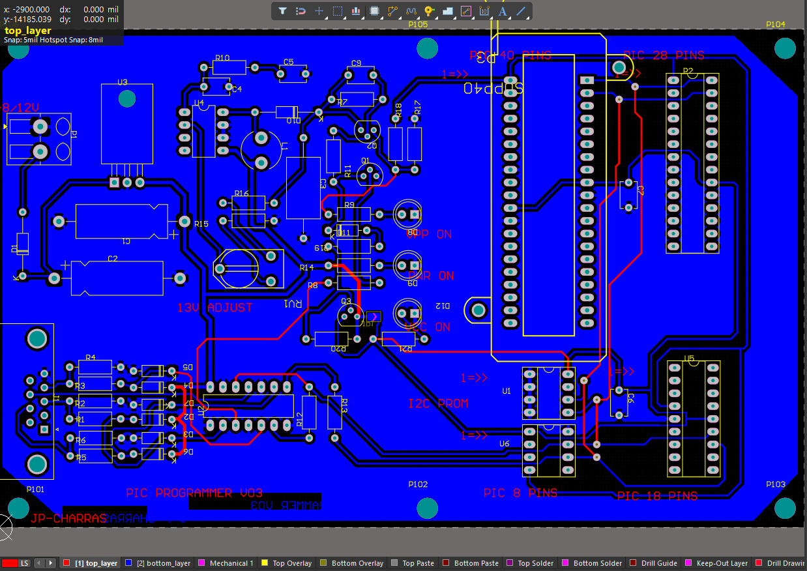

# pic_programmer in Altium Designer 26.11.1

Converted by kicad2altium from branch `k2a-ad26-open` (KiCad demos at 10.0.7, with their `.kicad_pro`), opened, checked and saved back by script in Altium Designer Professional 26.11.1 on Windows 11.

## 1. Open

No dialog, warning or error.

## 2. Look



## 3. Layer stack

2 copper layers: top_layer, bottom_layer.

Physical stack, top to bottom: Top Paste, Top Overlay, Top Solder, top_layer, Dielectric 1, bottom_layer, Bottom Solder, Bottom Overlay, Bottom Paste.

Mechanical layers in use: 1 Mechanical 1, 46 F.Fab, 47 B.Fab, 48 F.Courtyard, 49 B.Courtyard, 50 User.Drawings, 51 User.Comments, 52 F.Adhesive, 53 B.Adhesive, 54 User.Eco1, 55 User.Eco2, 56 Margin.

## 4. Counts

kicad2altium printed: 63 components, 247 pads, 6 vias, 1394 tracks, 65 arcs, 223 texts, 1 polygons, 7 regions, 111 nets, 0 models, 0 componentbodies

| | Altium (all) | not in a component |
|---|---|---|
| components | 63 | 63 |
| nets | 111 | 111 |
| pads | 247 | 0 |
| vias | 6 | 6 |
| tracks | 761 | 370 |
| arcs | 32 | 0 |
| texts | 92 | 19 |
| polygons | 1 | 1 |
| regions | 8 | 4 |
| component bodies | 0 | 0 |
| rules | 42 | 42 |
| classes | 18 | 18 |

Inside components (group iterator): pads=247 tracks=1024 arcs=65 texts=78 regions=4 fills=0 bodies=0.

Altium's board iterator does not visit every primitive inside components; their tracks, texts and pads are counted by the group iterator above, and the ASCII save below lists every record.

## 5. Polygons

Repour All: before polygons=1 pour primitives=3; after polygons=1 pour primitives=10. No error or dialog.

## 6. DRC

Default options, after the repour. Violations per rule (Altium stops at 500):

```
2  Clearance Constraint (Gap=11.024mil) (InNetClass('POWER')),(All)
     1  Clearance Constraint (Gap=9.842mil) (All),(All)
     0  Clearance Constraint (Gap=20mil) (InNamedPolygon('Polygon 0')),(All)
     2  Short-Circuit Constraint (Allowed=No) (All),(All)
     0  Un-Routed Net Constraint ( (All) )
     0  Modified Polygon (Allow modified: No), (Allow shelved: No)
     0  Width Constraint (Min=9.842mil) (Max=31.496mil) (Preferred=31.496mil) (InNetClass('POWER'))
     0  Width Constraint (Min=9.842mil) (Max=31.496mil) (Preferred=19.685mil) (All)
     0  Routing Topology Rule(Topology=Shortest) (All)
     0  Power Plane Connect Rule(Relief Connect )(Expansion=20mil) (Conductor Width=10mil) (Air Gap=10mil) (Entries=4) (All)
     0  Minimum Annular Ring (Minimum=1.968mil) (All)
     0  Hole Size Constraint (Min=19.685mil) (Max=169.291mil) (All)
     0  Hole To Hole Clearance (Gap=9.842mil) (All),(All)
     0  Minimum Solder Mask Sliver (Gap=10mil) (All),(All)
   174  Silk To Solder Mask (Clearance=10mil) (IsPad),(All)
     0  Silk to Silk (Clearance=0mil) (All),(All)
     0  Net Antennae (Tolerance=0mil) (All)
    12  Board Clearance Constraint (Gap=0mil) (All)
     0  Height Constraint (Min=0mil) (Max=1000mil) (Prefered=500mil) (All)
   191  TOTAL
```

## 7. Saved back

`pic_programmer.altium-saved.PcbDoc` (PCB Binary) and `pic_programmer.altium-ascii.PcbDoc` (PCB ASCII), saved without changes after opening (files over 20 MB gzipped).
