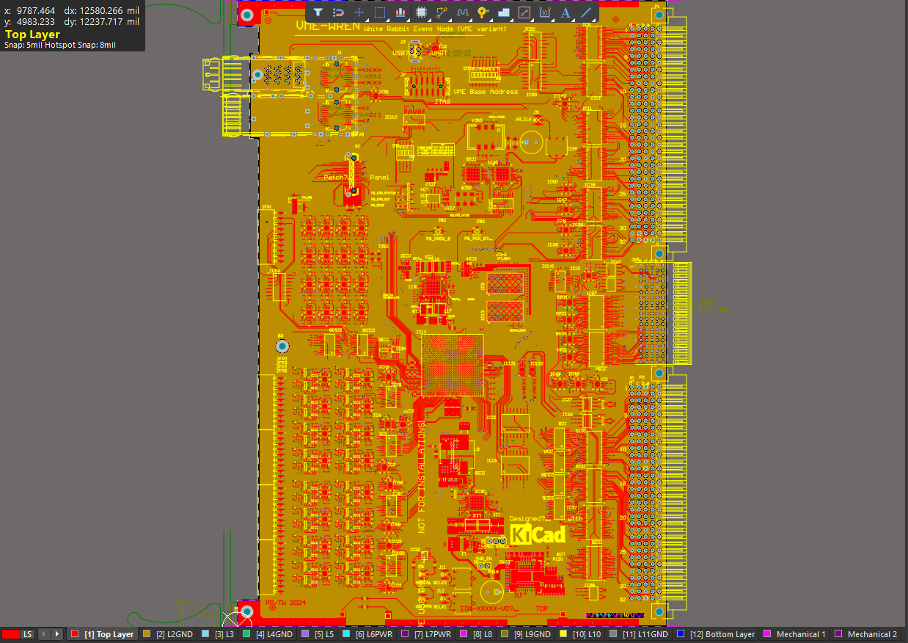

# vme-wren in Altium Designer 26.11.1

Converted by kicad2altium from branch `k2a-ad26-open` (KiCad demos at 10.0.7, with their `.kicad_pro`), opened, checked and saved back by script in Altium Designer Professional 26.11.1 on Windows 11.

## 1. Open

No dialog, warning or error.

## 2. Look



## 3. Layer stack

12 copper layers: Top Layer, L2GND, L3, L4GND, L5, L6PWR, L7PWR, L8, L9GND, L10, L11GND, Bottom Layer.

Physical stack, top to bottom: Top Paste, Top Overlay, Top Solder, Top Layer, Dielectric 1, L2GND, Dielectric 2, L3, Dielectric 3, L4GND, Dielectric 4, L5, Dielectric 5, L6PWR, Dielectric 6, L7PWR, Dielectric 7, L8, Dielectric 8, L9GND, Dielectric 9, L10, Dielectric 10, L11GND, Dielectric 11, Bottom Layer, Bottom Solder, Bottom Overlay, Bottom Paste.

Mechanical layers in use: 1 Mechanical 1, 2 Mechanical 2, 3 Mechanical 3, 4 Mechanical 4, 5 Corners, 6 Title Block, 7 Mechanical 7, 8 Notvisible, 9 Mechanical 9, 46 Top 3D Body, 47 Mechanical 13, 48 F.Courtyard, 49 B.Courtyard, 50 Top Assembly, 51 User.Comments, 52 F.Adhesive, 53 B.Adhesive, 54 User.Eco1, 55 Bottom Assembly, 56 Margin, 57 Mechanical 57.

## 4. Counts

kicad2altium printed: 1508 components, 6883 pads, 4374 vias, 52758 tracks, 3906 arcs, 3745 texts, 134 polygons, 159 regions, 1800 nets, 33 models, 164 componentbodies

| | Altium (all) | not in a component |
|---|---|---|
| components | 1508 | 1508 |
| nets | 1800 | 1800 |
| pads | 6883 | 0 |
| vias | 4374 | 4374 |
| tracks | 29779 | 25279 |
| arcs | 3010 | 2227 |
| texts | 1646 | 92 |
| polygons | 134 | 134 |
| regions | 160 | 153 |
| component bodies | 0 | 0 |
| rules | 283 | 283 |
| classes | 25 | 25 |

Inside components (group iterator): pads=6883 tracks=27054 arcs=1679 texts=216 regions=7 fills=0 bodies=164.

Altium's board iterator does not visit every primitive inside components; their tracks, texts and pads are counted by the group iterator above, and the ASCII save below lists every record.

## 5. Polygons

Repour All: before polygons=134 pour primitives=137; after polygons=134 pour primitives=879. No error or dialog.

## 6. DRC

Default options, after the repour. Violations per rule (Altium stops at 500):

```
0  Short-Circuit Constraint (Allowed=No) (All),(All)
   463  Un-Routed Net Constraint ( (All) )
     0  Modified Polygon (Allow modified: No), (Allow shelved: No)
     0  Width Constraint (Min=3.15mil) (Max=39.37mil) (Preferred=3.15mil) (InNetClass('FPGA_HP'))
     0  Width Constraint (Min=3.15mil) (Max=39.37mil) (Preferred=3.15mil) (InNetClass('DDR4_CMD'))
     0  Width Constraint (Min=3.15mil) (Max=39.37mil) (Preferred=3.15mil) (InNetClass('DDR4_BYTE3'))
     0  Width Constraint (Min=3.15mil) (Max=39.37mil) (Preferred=3.15mil) (All)
     0  Width Constraint (Min=3.15mil) (Max=39.37mil) (Preferred=3.15mil) (InNetClass('zse_50r'))
     0  Width Constraint (Min=3.937mil) (Max=39.37mil) (Preferred=5.906mil) (InNetClass('VMEPX'))
     0  Width Constraint (Min=3.15mil) (Max=39.37mil) (Preferred=3.15mil) (InNetClass('DDR4_BYTE2'))
     0  Width Constraint (Min=3.15mil) (Max=39.37mil) (Preferred=3.15mil) (InNetClass('DDR4_BYTE0'))
     0  Width Constraint (Min=3.15mil) (Max=39.37mil) (Preferred=3.15mil) (InNetClass('DDR4_BYTE1'))
     0  Routing Topology Rule(Topology=Shortest) (All)
     0  Power Plane Connect Rule(Relief Connect )(Expansion=20mil) (Conductor Width=10mil) (Air Gap=10mil) (Entries=4) (All)
     0  Minimum Annular Ring (Minimum=3.937mil) (All)
     0  Hole Size Constraint (Min=7.874mil) (Max=110.236mil) (All)
     0  Hole To Hole Clearance (Gap=9.842mil) (All),(All)
     0  Minimum Solder Mask Sliver (Gap=10mil) (All),(All)
     0  Silk To Solder Mask (Clearance=10mil) (IsPad),(All)
     0  Silk to Silk (Clearance=0mil) (All),(All)
     0  Net Antennae (Tolerance=0mil) (All)
    37  Board Clearance Constraint (Gap=0mil) (All)
     0  Height Constraint (Min=0mil) (Max=1000mil) (Prefered=500mil) (All)
   500  TOTAL
```

## 7. Saved back

`vme-wren.altium-saved.PcbDoc` (PCB Binary) and `vme-wren.altium-ascii.PcbDoc` (PCB ASCII), saved without changes after opening (files over 20 MB gzipped).
